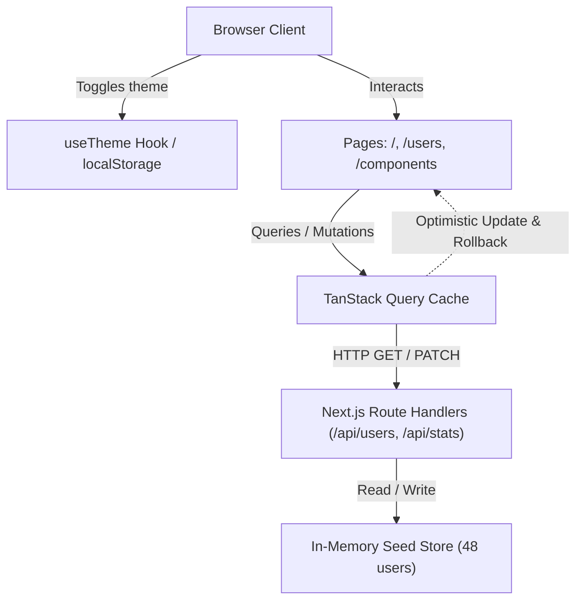

# UIForge

A React component library and admin dashboard built with Next.js App Router, TypeScript, and Tailwind CSS. UIForge provides accessible UI components alongside an administrative dashboard featuring data visualization, debounced search, server-side-style pagination, sorting, and optimistic mutations with rollback.

## Features

- **Component Library**: Accessible UI primitives including `Button`, `Card`, `Badge`, `Modal`, `Table`, `Input`, `Select`, `Tabs`, `Toast`, and `Pagination`.
- **Admin Dashboard**: Overview metrics cards with responsive bar and donut charts powered by Recharts, dynamically imported on client demand.
- **Users Management**: Table supporting debounced text search, column sorting, pagination, and one-click status toggling.
- **Optimistic Updates**: Immediate UI state reflection on user status change using TanStack Query mutation with automatic rollback on server error.
- **Dark Mode**: Persisted light/dark mode preference via `localStorage` and `prefers-color-scheme`, with an inline head script to eliminate theme flicker.
- **Mock REST API**: Next.js route handlers (`/api/users`, `/api/stats`) backed by deterministic seeded data (48 user records).
- **Interactive Showcase**: Dedicated `/components` page demonstrating every component variant and interactive state.
- **Tested**: Comprehensive test suite using Vitest and React Testing Library covering components, hooks, seed generation, and API handlers.

## Stack

- **Framework**: Next.js 15 (App Router)
- **Language**: TypeScript
- **UI Library**: React 19
- **Styling**: Tailwind CSS
- **Data Fetching & State**: TanStack Query (React Query v5)
- **Data Visualization**: Recharts
- **Testing**: Vitest, React Testing Library, jsdom
- **Linting**: ESLint with next/core-web-vitals

## Architecture



## Getting Started

### Prerequisites

- Node.js 20+
- npm 10+

### Installation

Clone the repository and install dependencies:

```bash
git clone <repo-url>
cd UIForge
npm install
```

Copy the example environment configuration:

```bash
cp .env.example .env.local
```

### Development Server

Start the local development server on `http://localhost:3000`:

```bash
npm run dev
```

### Production Build

Create an optimized production build:

```bash
npm run build
npm run start
```

### Testing & Quality Checks

Run the Vitest test suite:

```bash
npm run test
```

Run linting:

```bash
npm run lint
```

Run typechecking:

```bash
npm run typecheck
```

## Component Usage Examples

### Button

```tsx
import { Button } from "@/components";

export function Example() {
  return (
    <div className="flex gap-2">
      <Button variant="primary" size="md">Save</Button>
      <Button variant="secondary">Cancel</Button>
      <Button variant="danger" loading>Deleting...</Button>
    </div>
  );
}
```

### Table with Sorting

```tsx
import { Table, Column } from "@/components";

interface User {
  id: number;
  name: string;
  role: string;
}

const columns: Column<User>[] = [
  { key: "id", header: "ID", sortable: true },
  { key: "name", header: "Name", sortable: true },
  { key: "role", header: "Role" },
];

export function UserList({ users }: { users: User[] }) {
  return (
    <Table
      columns={columns}
      data={users}
      sortKey="name"
      sortDir="asc"
      onSort={(key) => console.log("Sort by", key)}
      keyExtractor={(user) => user.id}
    />
  );
}
```

### Modal

```tsx
import { useState } from "react";
import { Modal, Button } from "@/components";

export function DialogDemo() {
  const [open, setOpen] = useState(false);

  return (
    <>
      <Button onClick={() => setOpen(true)}>Open Modal</Button>
      <Modal open={open} onClose={() => setOpen(false)} title="Confirm Action">
        <p className="text-sm text-gray-600 dark:text-gray-400">
          Are you sure you want to proceed?
        </p>
        <div className="mt-4 flex justify-end gap-2">
          <Button variant="secondary" onClick={() => setOpen(false)}>Cancel</Button>
          <Button onClick={() => setOpen(false)}>Confirm</Button>
        </div>
      </Modal>
    </>
  );
}
```

### Toast Notifications

```tsx
import { useToast } from "@/components";

export function ActionButton() {
  const { addToast } = useToast();

  return (
    <button onClick={() => addToast("Changes published successfully", "success")}>
      Publish
    </button>
  );
}
```

## API Reference

### `GET /api/users`

Returns paginated list of users.

- **Query Parameters**:
  - `search` (string, optional): Filter by name, email, or role
  - `page` (number, default: 1): Page number
  - `limit` (number, default: 10, max: 50): Page size
  - `sortBy` (string, default: "id"): Column to sort by
  - `sortDir` ("asc" | "desc", default: "asc"): Sort order

**Sample Response**:
```json
{
  "data": [
    {
      "id": 1,
      "name": "Alice Smith",
      "email": "alice.smith@example.com",
      "role": "admin",
      "status": "active",
      "joinedAt": "2024-03-15"
    }
  ],
  "total": 48,
  "page": 1,
  "totalPages": 5
}
```

### `PATCH /api/users`

Updates user attributes.

- **Request Body**:
```json
{
  "id": 1,
  "status": "inactive"
}
```

- **Response**: The updated user object (`200 OK`) or `{ "error": "User not found" }` (`404 Not Found`).

### `GET /api/stats`

Returns aggregated counts and charts series data derived from the seed dataset.

**Sample Response**:
```json
{
  "total": 48,
  "active": 36,
  "inactive": 12,
  "signupsByMonth": [
    { "month": "2024-01", "count": 3 },
    { "month": "2024-02", "count": 5 }
  ],
  "roleBreakdown": [
    { "name": "Admin", "value": 14 },
    { "name": "Editor", "value": 16 },
    { "name": "Viewer", "value": 18 }
  ]
}
```

## Project Structure

```
UIForge/
├── .github/
│   └── workflows/
│       └── ci.yml               # GitHub Actions CI (lint, typecheck, test, build)
├── src/
│   ├── app/
│   │   ├── api/
│   │   │   ├── stats/route.ts   # Stats aggregation endpoint
│   │   │   └── users/route.ts   # Users CRUD endpoint with pagination & filtering
│   │   ├── components/page.tsx  # Component library interactive showcase
│   │   ├── users/page.tsx       # Users table page with search, sort, pagination
│   │   ├── globals.css          # Tailwind CSS base styles
│   │   ├── layout.tsx           # Root layout with sidebar and theme bootstrap
│   │   └── page.tsx             # Dashboard page with dynamic charts
│   ├── components/
│   │   ├── charts/
│   │   │   ├── role-chart.tsx   # Recharts donut chart
│   │   │   └── signups-chart.tsx# Recharts bar chart
│   │   ├── badge.tsx
│   │   ├── button.tsx
│   │   ├── card.tsx
│   │   ├── index.ts
│   │   ├── input.tsx
│   │   ├── mobile-nav.tsx
│   │   ├── modal.tsx
│   │   ├── pagination.tsx
│   │   ├── select.tsx
│   │   ├── sidebar.tsx
│   │   ├── table.tsx
│   │   ├── tabs.tsx
│   │   ├── theme-toggle.tsx
│   │   └── toast.tsx
│   ├── data/
│   │   └── seed.ts              # Seed generator and stats calculator
│   ├── hooks/
│   │   ├── use-debounce.ts      # Value debounce hook
│   │   ├── use-theme.ts         # Theme hook with localStorage persistence
│   │   └── use-users.ts         # TanStack Query hooks + optimistic mutations
│   ├── test/
│   │   ├── api.test.ts          # Route handler unit tests
│   │   ├── components.test.tsx  # UI component tests
│   │   ├── hooks.test.ts        # Custom hook tests
│   │   ├── seed.test.ts         # Deterministic seed tests
│   │   ├── setup.ts             # Vitest DOM matchers setup
│   │   └── table.test.tsx       # Table accessibility & sorting tests
│   └── providers.tsx            # QueryClient & Toast context providers
├── .env.example
├── .gitignore
├── eslint.config.mjs
├── LICENSE                      # MIT License
├── next.config.mjs
├── package.json
├── package-lock.json
├── postcss.config.js
├── README.md
├── tailwind.config.js
├── tsconfig.json
└── vitest.config.ts
```

## What I'd Improve Next

- **Persistent backend database**: Replace the in-memory array with PostgreSQL via Prisma or Drizzle ORM for multi-process persistence.
- **Form validation**: Integrate Zod and React Hook Form for client and server input validation with shared schemas.
- **Column visibility & filtering**: Add multi-field filter dropdowns (filter by role or status) and toggleable column visibility on the users table.
- **Toast action buttons**: Support undo actions inside toast alerts when reversing status changes.
- **Full keyboard trap in modal**: Add focus trapping with focus-trap or floating-ui to restrict Tab navigation strictly within open modal dialogs.

## License

MIT © 2026 Vineet Kumar
